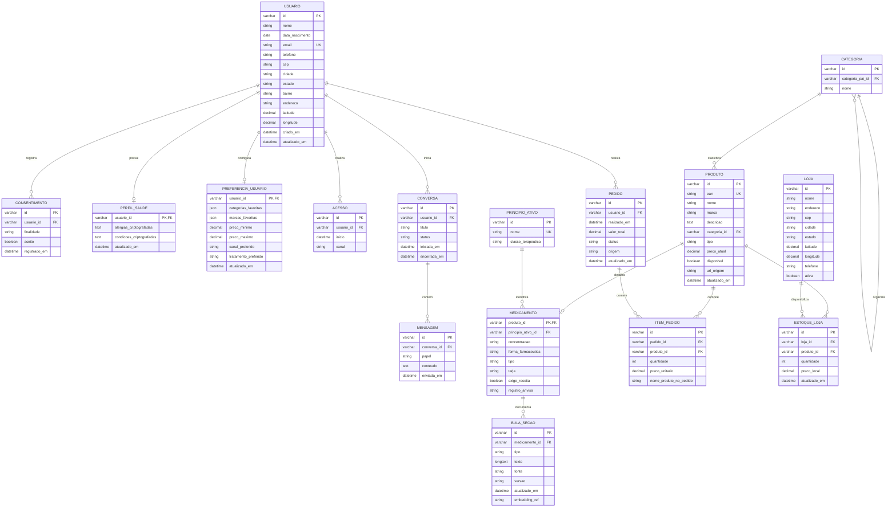

# Documentação do Banco de Dados: Chatbot Farmácia (IA Commerce)

Este documento detalha o modelo de dados relacional projetado para o assistente virtual de IA da rede de farmácias. O banco de dados foi construído com compatibilidade para o **MySQL 8.0+**, utilizando chaves primárias e estrangeiras padronizadas em `VARCHAR(50)` (suportando UUIDs e códigos alfanuméricos), conformidade com a LGPD, catálogo hierárquico, especialização para medicamentos com suporte a RAG (busca semântica em bulas) e logística omnichannel.

---

## 1. Diagrama Entidade-Relacionamento (ERD)

Abaixo está a representação conceitual e lógica do banco de dados idêntica à apresentada no `mermaid-diagram.png`:



---

## 2. Visão Geral dos Módulos

O esquema é dividido em **6 módulos funcionais integrados**:

```
                       ┌────────────────────────────────┐
                       │   1. Usuários & Privacidade    │
                       │ (USUARIO, CONSENTIMENTO, etc.) │
                       └───────────────┬────────────────┘
                                       │
            ┌──────────────────────────┼──────────────────────────┐
            ▼                          ▼                          ▼
┌───────────────────────┐  ┌───────────────────────┐  ┌───────────────────────┐
│ 2. Conversação & IA   │  │ 5. Pedidos & Comércio │  │ 6. Lojas & Estoque    │
│ (CONVERSA, MENSAGEM)  │  │ (PEDIDO, ITEM_PEDIDO) │  │ (LOJA, ESTOQUE_LOJA)  │
└───────────────────────┘  └───────────┬───────────┘  └───────────┬───────────┘
                                       │                          │
                                       └───────────┬──────────────┘
                                                   ▼
                                       ┌───────────────────────┐
                                       │ 3. Catálogo & Regras  │
                                       │ (PRODUTO, CATEGORIA)  │
                                       └───────────┬───────────┘
                                                   ▼
                                       ┌───────────────────────┐
                                       │ 4. Medicamentos & RAG │
                                       │ (MEDICAMENTO, BULAS)  │
                                       └───────────────────────┘
```

---

## 3. Detalhamento das Tabelas

### Módulo 1: Usuários, Privacidade e Hiperpersonalização

#### `USUARIO`
- **Função:** Tabela principal de clientes da farmácia.
- **Campos Principais:**
  - `id`: Identificador único padronizado (`VARCHAR(50)`, suportando UUIDs v4 e códigos alfanuméricos).
  - `email`: E-mail único para autenticação e contato.
  - `latitude` / `longitude`: Coordenadas do cliente para cálculo de distância da filial mais próxima e entrega rápida.
- **Validações:** Validações `CHECK` que asseguram latitude entre -90 e 90, e longitude entre -180 e 180.

#### `CONSENTIMENTO`
- **Função:** Atendimento à LGPD (Lei Geral de Proteção de Dados - Lei nº 13.709/2018).
- **Relacionamento:** 1 Usuário possui N Consentimentos.
- **Campos:** `finalidade` (ex: "historico_compras", "perfil_saude"), `aceito` (booleano) e data de registro com carimbo `registrado_em`.

#### `PERFIL_SAUDE`
- **Função:** Armazenamento seguro de dados clínicos sensíveis (Art. 11 da LGPD).
- **Relacionamento:** 1 Usuário possui 1 Perfil de Saúde (1:1 com `usuario_id` como PK e FK).
- **Campos:** `alergias_criptografadas` e `condicoes_criptografadas`. Os dados devem ser criptografados na camada da aplicação antes da persistência.

#### `PREFERENCIA_USUARIO`
- **Função:** Armazena parâmetros para a IA personalizar a recomendação de produtos durante a conversa.
- **Relacionamento:** 1 Usuário possui 1 Perfil de Preferências (1:1).
- **Campos:** `categorias_favoritas` (JSON), `marcas_favoritas` (JSON), `preco_minimo`, `preco_maximo`, `canal_preferido` e `tratamento_preferido`.
- **Validações:** Garantia de valores não-negativos e que `preco_minimo <= preco_maximo`.

#### `ACESSO`
- **Função:** Telemetria de acessos e logins do usuário por canal (ex.: Web ou App móvel).
- **Relacionamento:** 1 Usuário realiza N Acessos.

---

### Módulo 2: Conversação e Atendimento de IA (Chatbot)

#### `CONVERSA`
- **Função:** Representa uma sessão de atendimento ou thread entre o cliente e o assistente de IA.
- **Relacionamento:** 1 Usuário inicia N Conversas.
- **Campos:** `titulo`, `status` (`'ativa'`, `'encerrada'`, `'arquivada'`), `iniciada_em` e `encerrada_em`.

#### `MENSAGEM`
- **Função:** Histórico turno a turno da conversa.
- **Relacionamento:** 1 Conversa contém N Mensagens.
- **Campos:** `papel` (`'usuario'`, `'assistente'`, `'sistema'`), `conteudo` (texto do prompt ou resposta gerada) e `enviada_em`.
- **Índices:** Indexado por `(conversa_id, enviada_em)` para rápida recuperação do histórico de contexto no envio à API de LLM (Gemini).

---

### Módulo 3: Catálogo de Produtos e Categorias

#### `CATEGORIA`
- **Função:** Taxonomia dos produtos da farmácia.
- **Auto-relacionamento:** Possui `categoria_pai_id` apontando para a própria tabela `CATEGORIA`, permitindo árvores de categorias hierárquicas ilimitadas (ex: *Medicamentos > Dor e Febre > Analgésicos*).

#### `PRODUTO`
- **Função:** Catálogo unificado de SKUs da farmácia (cosméticos, suplementos, higiene, medicamentos).
- **Campos:** `ean` (código de barras único internacional), `nome`, `marca`, `descricao`, `categoria_id`, `tipo`, `preco_atual`, `disponivel` e `url_origem`.
- **Índices:** Indexado por `nome`, `marca`, `categoria_id` e par `(tipo, disponivel)` para acelerar filtros de catálogo.

---

### Módulo 4: Especialização Farmacêutica e Busca Semântica (RAG)

#### `PRINCIPIO_ATIVO`
- **Função:** Registro das substâncias ativas e moléculas (ex: *Dipirona Sódica*, *Paracetamol*, *Ibuprofeno*) e sua respectiva `classe_terapeutica` (ex: *Analgésico e Antipirético*).
- **Uso pela IA:** Permite à IA sugerir alternativas genéricas ou similares autorizadas.

#### `MEDICAMENTO`
- **Função:** Especialização da tabela `PRODUTO` (relação 1:1 onde `produto_id` é PK e FK).
- **Campos Específicos:** `principio_ativo_id`, `concentracao`, `forma_farmaceutica` (comprimido, gotas, xarope), `tarja` (livre, amarela, vermelha, preta), `exige_receita` (booleano) e `registro_anvisa`.
- **Regras Regulatórias:** Essencial para o chatbot não efetuar venda direta de remédios controlados sem validação de receita médica.

#### `BULA_SECAO`
- **Função:** Armazenamento fatiado (chunking) das bulas para busca semântica em arquitetura RAG (*Retrieval-Augmented Generation*).
- **Campos:**
  - `tipo`: Seção da bula (ex: "Indicações", "Contraindicações", "Como Usar", "Posologia", "Reações Adversas", "Superdosagem").
  - `texto`: Texto completo da respectiva seção (`LONGTEXT`).
  - `embedding_ref`: Identificador/URI do vetor em banco vetorial de alta performance para busca semântica.

---

### Módulo 5: Pedidos e Comércio Conversacional

#### `PEDIDO`
- **Função:** Transações de compra originadas diretamente do chatbot ou integradas ao e-commerce.
- **Campos:** `valor_total`, `status` (`'pendente'`, `'confirmado'`, `'processando'`, `'enviado'`, `'concluido'`, `'cancelado'`, `'devolvido'`) e `origem` (ex: "chatbot_whatsapp", "chatbot_web").

#### `ITEM_PEDIDO`
- **Função:** Itens que compõem cada pedido (relação N:N entre `PEDIDO` e `PRODUTO`).
- **Campos:** `quantidade`, `preco_unitario` e `nome_produto_no_pedido` (preserva o nome exato no momento da venda para integridade contábil).

---

### Módulo 6: Logística e Presença Omnichannel

#### `LOJA`
- **Função:** Dados das farmácias físicas da rede.
- **Campos:** Endereço completo, telefone, status de atividade (`ativa`) e coordenadas geográficas (`latitude`, `longitude`) para cálculo de distância via fórmula de Haversine ou funções espaciais do MySQL.

#### `ESTOQUE_LOJA`
- **Função:** Controle de estoque por loja e flexibilidade de preço regional.
- **Relacionamento:** N:N entre `LOJA` e `PRODUTO`.
- **Campos:** `quantidade` disponível na filial específica e `preco_local` (preço praticado naquela loja física).

---

## 4. Ordem de Criação e Execução dos Scripts

A tabela a seguir apresenta a ordem exata de dependências para criação segura das tabelas (sem violação de Foreign Keys):

| Ordem | Arquivo | Nível de Dependência | Entidades Referenciadas |
| :---: | :--- | :---: | :--- |
| **00** | `tables/00_database.sql` | 0 | Nenhuma (Cria o banco `chatbot_farmacia`) |
| **01** | `tables/01_usuario.sql` | 0 | Nenhuma |
| **02** | `tables/02_consentimento.sql` | 1 | `USUARIO` |
| **03** | `tables/03_perfil_saude.sql` | 1 | `USUARIO` |
| **04** | `tables/04_preferencia_usuario.sql` | 1 | `USUARIO` |
| **05** | `tables/05_acesso.sql` | 1 | `USUARIO` |
| **06** | `tables/06_conversa.sql` | 1 | `USUARIO` |
| **07** | `tables/07_mensagem.sql` | 2 | `CONVERSA` |
| **08** | `tables/08_categoria.sql` | 0 | Auto-relacionamento (`CATEGORIA`) |
| **09** | `tables/09_produto.sql` | 1 | `CATEGORIA` |
| **10** | `tables/10_pedido.sql` | 1 | `USUARIO` |
| **11** | `tables/11_item_pedido.sql` | 2 | `PEDIDO`, `PRODUTO` |
| **12** | `tables/12_principio_ativo.sql` | 0 | Nenhuma |
| **13** | `tables/13_medicamento.sql` | 2 | `PRODUTO`, `PRINCIPIO_ATIVO` |
| **14** | `tables/14_bula_secao.sql` | 3 | `MEDICAMENTO` |
| **15** | `tables/15_loja.sql` | 0 | Nenhuma |
| **16** | `tables/16_estoque_loja.sql` | 2 | `LOJA`, `PRODUTO` |

---

## 5. Como Executar

Execute o script unificado a partir da pasta sql do projeto:

```bash
cd sql/

# Execução direta via terminal:
mysql -u <usuario> -p < executar_todos.sql

# Ou dentro do console MySQL:
mysql> SOURCE executar_todos.sql;
```

O script mestre `executar_todos.sql` carrega cada arquivo na sequência correta, garantindo que o banco de dados seja provisionado com 100% de integridade referencial.
